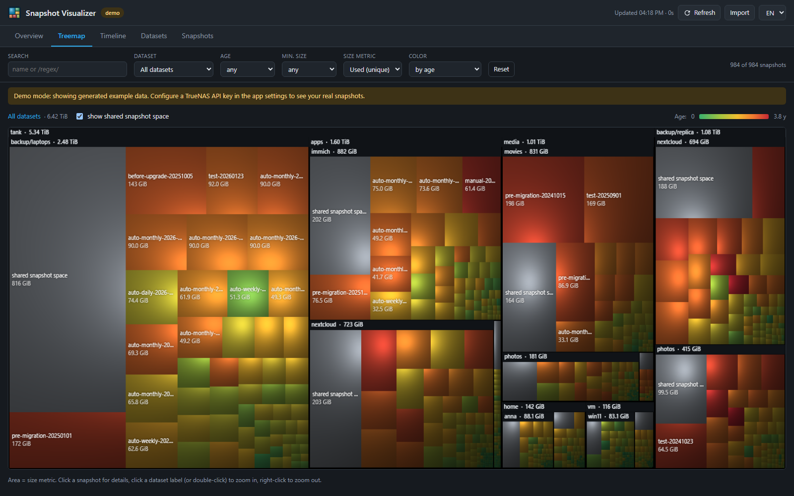

# TrueNAS Snapshot Visualizer

See where your ZFS snapshot space goes, the way WinDirStat shows files.



**Snapshot Visualizer** is a small TrueNAS app with a web UI. It reads all datasets and snapshots
read-only through the TrueNAS API and shows them as:

- **Overview** – snapshot space, unique vs. shared space, age distribution, largest snapshots,
  datasets with the most snapshot space and space per *naming schema* (= per periodic snapshot task).
- **Treemap** – a WinDirStat-style cushion treemap (pool → dataset → snapshot). Area = size, color = age,
  dataset or naming schema. Click to zoom into a dataset, right-click to zoom out.
  The grey "shared snapshot space" blocks show space that belongs to *several* snapshots and is only freed
  when all of them are deleted.
- **Timeline** – space by creation date plus one lane per dataset with a bubble per snapshot.
- **Datasets** – sortable table with snapshot count, snapshot space, shared space, data vs. snapshot ratio,
  oldest/newest snapshot.
- **Snapshots** – sortable, filterable, virtualised table for tens of thousands of snapshots, CSV export.

Filters (search, dataset, age, minimum size), size metric (`used`, `written`, `referenced`) and color mode
apply to every view.
The address bar always holds the current view, filters, treemap zoom and selected snapshot, so you can
bookmark a view or send it as a link.
The search box understands more than names: `>10g` or `5m..1g` (size in the selected metric), `used>1g`,
`written<100m`, `ref>2t`, `age>30d` or `age:7d..30d`, `-hourly` (exclude), `held` and `/regex/`; terms are combined
with AND, e.g. `tank/vm age>90d >1g`.
Keyboard: `?` lists all shortcuts – `/` search, `1`–`5` views, `↑`/`↓` or `j`/`k` through the snapshots table,
`Space` marks a snapshot, `Backspace` zooms the treemap out.
The details panel shows ready-to-copy `zfs` commands, deletion only as a dry run
(`zfs destroy -nv`), and `zfs diff` commands that list which files a snapshot holds (the TrueNAS API cannot
run `zfs diff`, so you paste them into the TrueNAS shell). By default the app is read-only; deleting snapshots from the UI is an opt-in feature (`SNAPVIZ_ALLOW_DELETE`).

UI languages: English, German.

## Installation on TrueNAS

### From the TrueNAS app catalog

*Apps → Discover Apps → search for "Snapshot Visualizer" → Install* (once the app is accepted in the
community train).

### As a custom app – no API key needed

*Apps → Discover Apps → ⋮ → Install via YAML* and paste:

```yaml
services:
  snapshot-visualizer:
    image: ghcr.io/synecho/truenas-snapshot-visualizer:1.3.0
    user: "0:0"
    read_only: true
    cap_drop: [ALL]
    security_opt: ["no-new-privileges=true"]
    restart: unless-stopped
    ports:
      - "30527:8080"
    volumes:
      - /var/run/middleware:/run/middleware:ro
    environment:
      SNAPVIZ_PASSWORD: "<choose a password>"
```

Then open `https://<your-truenas>:30527` and confirm the certificate warning once (the app uses a self-signed
certificate, like the TrueNAS web interface).

The app talks to the TrueNAS middleware through its local socket `/var/run/middleware/middlewared.sock`.
TrueNAS authenticates socket connections by the caller's UID, so no key or password is involved:

- `user: "0:0"` (above) – zero configuration. The container gets **full admin rights** on the TrueNAS API.
  The app only runs read-only queries (unless deleting is enabled), but a vulnerability in it would expose
  your whole NAS – so set a password.
- **Read-only (recommended)** – create a user in a group with the *Read-Only Administrator* privilege
  (see below, steps 1–2, no key needed), look up its UID under *Credentials → Users* and use
  `user: "<uid>:<uid>"` instead. The container can then only read.

The official app catalog does not allow apps to mount `/var/run/middleware`, so the catalog version of the
app uses an API key instead.

### HTTPS and login

- **HTTPS is on by default** (`SNAPVIZ_TLS=auto`) with a self-signed certificate that is generated at start.
  Without storage it changes on every restart, so the browser warns again. To keep it, mount a writable
  directory and set `SNAPVIZ_DATA_DIR` (it also keeps logins across restarts):
  ```yaml
      volumes:
        - /mnt/<pool>/apps/snapviz:/data
      environment:
        SNAPVIZ_DATA_DIR: /data
  ```
  Own certificate: `SNAPVIZ_TLS_CERT` / `SNAPVIZ_TLS_KEY` (PEM files mounted into the container).
  Behind a reverse proxy that already does TLS: `SNAPVIZ_TLS: "off"`.
- **Login:** set `SNAPVIZ_PASSWORD` and the web UI asks for it. Sessions are signed cookies
  (HttpOnly, SameSite=Strict, Secure) valid for 30 days; 10 failed attempts lock an IP for 10 minutes.
  Without a password the UI is open to everyone who can reach it.

### Deleting snapshots from the UI (optional)

Off by default. To enable it, add to the YAML:

```yaml
    environment:
      SNAPVIZ_ALLOW_DELETE: "true"
```

Then select snapshots (checkboxes in the *Snapshots* table, Ctrl+click in the treemap or timeline, or in the
details panel) and use **Edit → Delete selected snapshots…**. The confirmation dialog shows the list, the
minimum space that will be freed, skips snapshots with a `zfs hold`, warns about the newest snapshot of a dataset
(replication) and asks you to type the number of snapshots.

- Deleting needs the TrueNAS role `SNAPSHOT_DELETE`: works with `user: "0:0"` on the socket or with a Full Admin
  API key, **not** with a Read-Only Administrator.
- **Set `SNAPVIZ_PASSWORD`** – otherwise everyone who can reach the web UI can delete snapshots.
- Cross-site requests are rejected (custom header + origin check), only snapshot names (`pool/ds@snap`) that are
  part of the loaded data are accepted, and every deletion is logged in the app log.

### With an API key

Needed for the catalog version or to look at another TrueNAS system over the network.
Replace `user` and `volumes` in the YAML above with

```yaml
    user: "568:568"
    extra_hosts:
      - "host.docker.internal:host-gateway"
    environment:
      TRUENAS_HOST: host.docker.internal
      TRUENAS_API_KEY: "<your API key>"
```

If both the socket and a key are configured, the app uses the socket and falls back to the key when the
container user has no TrueNAS privileges.

### Creating a read-only user and API key

For the read-only socket variant you only need steps 1–2. The API key needs read access to pools,
datasets and snapshots. The safest option is a dedicated user:

1. **Credentials → Users → Add**: e.g. `snapviz`, *Disable Password* on, no shell, no SMB.
2. Put the user into a group that has the **Read-Only Administrator** privilege
   (*Credentials → Groups → edit → Privileges*).
3. User menu at the top right → **My API Keys → Add**, select the user and copy the key
   (it is shown only once). On TrueNAS 24.10 keys are global: *Settings menu → API Keys → Add*.
4. Paste it into the app settings (*TrueNAS API Key*).

On TrueNAS 25.04+ the app logs in with `auth.login_with_api_key`. If a future TrueNAS version drops that
method, set the additional environment variable `TRUENAS_USERNAME` to the key's user name and the app
uses `auth.login_ex` instead.

The app connects to `https://host.docker.internal` (the TrueNAS system it runs on). TrueNAS **revokes API keys
that are sent over unencrypted HTTP**, so the app always uses HTTPS/WSS; if you enter a host with `http://`
the app refuses to send the key. Keep *Verify TLS Certificate* off for the default self-signed certificate.

## Configuration (environment variables)

| Variable | Default | Description |
|---|---|---|
| `SNAPVIZ_SOURCE` | `truenas` | `truenas` (API), `demo` (generated data) or `zfs` (local `zfs` binary) |
| `TRUENAS_SOCKET` | `/run/middleware/middlewared.sock` | Middleware socket inside the container (used when it exists) |
| `TRUENAS_USE_SOCKET` | `true` | Set to `false` to ignore a mounted socket and always use the API key |
| `TRUENAS_HOST` | `host.docker.internal` | Host name, IP or URL of the TrueNAS web UI |
| `TRUENAS_API_KEY` | – | API key |
| `TRUENAS_VERIFY_TLS` | `false` | Verify the TLS certificate |
| `TRUENAS_USERNAME` | – | Optional: user owning the key, switches login to `auth.login_ex` |
| `SNAPVIZ_CACHE_SECONDS` | `300` | Cache lifetime; the Refresh button bypasses the cache |
| `SNAPVIZ_ALLOW_IMPORT` | `true` | Allow uploading `zfs list` output in the UI |
| `SNAPVIZ_ALLOW_DELETE` | `false` | Allow deleting snapshots in the UI (see above) |
| `SNAPVIZ_EXCLUDE_DATASETS` | `*/.system*,*/.ix-apps/docker*,*/ix-applications/docker*,*/ix-applications/k3s*` | Comma-separated globs (`*`, `?`, full dataset name) for TrueNAS internals. Matching datasets are hidden while *hide system datasets* is on (default); empty = hide nothing |
| `SNAPVIZ_PORT` | `8080` | Port the web server listens on |
| `SNAPVIZ_TLS` | `auto` | `auto` = HTTPS with self-signed certificate, `off` = plain HTTP |
| `SNAPVIZ_TLS_CERT` / `SNAPVIZ_TLS_KEY` | – | Own certificate and key (PEM) |
| `SNAPVIZ_PASSWORD` | – | Password for the web UI; empty = no login |
| `SNAPVIZ_DATA_DIR` | – | Writable directory to keep the certificate and session key |
| `SNAPVIZ_LOG_LEVEL` | `INFO` | Python log level |

### Without TrueNAS: import `zfs list` output

The *Import* button accepts the output of

```sh
zfs list -Hp -t filesystem,volume -o name,type,used,usedbysnapshots,usedbydataset,usedbychildren,available,referenced > zfs.txt
zfs list -Hp -t snapshot -o name,used,referenced,written,creation,userrefs >> zfs.txt
```

from any ZFS system (Proxmox, Linux, FreeBSD, …). Nothing is stored on the server.

## Understanding the numbers

- **used** of a snapshot = space that is *only* in this snapshot. Deleting just this snapshot frees this much.
- **usedbysnapshots** of a dataset = all space held by its snapshots. It is usually *larger* than the sum of
  the snapshots' `used`, because blocks referenced by two or more snapshots are not counted in any single
  snapshot. The app shows this difference as **shared** space.
- **written** = data written to the dataset between the previous snapshot and this one (≈ change rate).
- **referenced** = size of the dataset as it was when the snapshot was taken.

## Development

```sh
cd app
python -m venv .venv && . .venv/bin/activate
pip install -r requirements.txt pytest pytest-aiohttp trustme ruff==0.16.9
SNAPVIZ_SOURCE=demo python -m snapviz      # http://localhost:8080
pytest -q && ruff check .
npm ci && npm run lint && npm test         # Biome lint + node:test for the frontend
```

The frontend is plain HTML/CSS/JavaScript without build step or runtime dependencies (`app/static`);
Node is only needed for linting and tests. CI runs all of the above on every pull request.
The backend is a small aiohttp server (`app/snapviz`).

```
app/                     Docker image (backend + static UI)
truenas-catalog/         files for a pull request to github.com/truenas/apps (ix-dev/community/snapshot-visualizer)
.github/workflows/       builds and publishes ghcr.io/<owner>/truenas-snapshot-visualizer
```

## License

MIT
